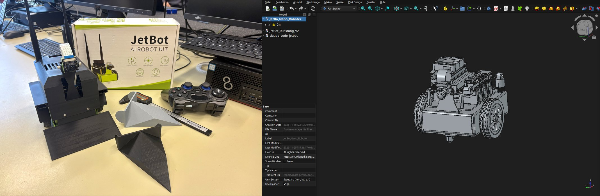

<p align="center">
  <picture>
    <source media="(prefers-color-scheme: dark)" srcset="assets/mapeit04_logo_dark.svg">
    
  </picture>
</p>

<p align="center">
  <a href="https://de.linkedin.com/in/marc-adrian-pentia-98a07a389"></a>
  <a href="https://www.youtube.com/@marcpentia"></a>
  
  <a href="https://github.com/mapeit04/jetbot-ag/stargazers"></a>
</p>

<hr>

<h1 align="center">🤖 JetBot Nano AG</h1>

<p align="center">
  
</p>

<h3 align="center">Hochschule Esslingen · Robotik-AG</h3>

Willkommen in der JetBot AG der Hochschule Esslingen!

In dieser AG bringen wir einen kleinen autonomen Roboter auf Basis des
**NVIDIA Jetson Nano** zum Leben: von den ersten Fahrbefehlen über Kamera
und Gamepad-Steuerung bis hin zu **künstlicher Intelligenz**, mit der der
Roboter selbstständig Hindernissen ausweicht.

Zum Abschluss designt jede Gruppe ein eigenes Addon für den 3D-Drucker
und tritt damit beim **Roboter-Sumo** gegen die anderen an. 🏆

---

## 📅 Ablauf

| Nr. | Thema | Inhalt |
|-----|-------|--------|
| 1 | Montage & Inbetriebnahme | JetBot zusammenbauen, einrichten, verbinden |
| 2 | Linux-Grundlagen | Terminal, Dateien, erste Befehle |
| 3 | Fahrschule | Motoren ansteuern, Fahrfiguren, eigene Steuerung |
| 4 | Teleoperation | Gamepad, Kamera, Fotos |
| 5 | Collision Avoidance | Daten sammeln, KI trainieren, autonom fahren |
| 6 | Sumo-Addon | eigenes Addon in FreeCAD designen und drucken |
| 7 | Roboter-Sumo | das große Finale |

---

## 📚 Anleitungen

| Thema | Anleitung |
|-------|-----------|
| Einführung | [`docs/01_einfuehrung/`](docs/01_einfuehrung/) |
| Montage | [`docs/02_montage/`](docs/02_montage/) |
| Inbetriebnahme | [`docs/03_inbetriebnahme/`](docs/03_inbetriebnahme/) |
| Linux-Grundlagen | [Linux-Grundbefehle](docs/Linux_Grundkenntnisse/Linux_grundbefehle.md) · [Ubuntu einrichten](docs/Linux_Grundkenntnisse/Ubuntu_einrichten.md) |
| Teleoperation | [`docs/04_Teleoperation/`](docs/04_Teleoperation/) |
| Objekterkennung | [`docs/05_Objekterkennung/`](docs/05_Objekterkennung/) |
| Spurenverfolgung | [`docs/06_Spurenverfolgung/`](docs/06_Spurenverfolgung/) |
| FreeCAD | [`docs/07_FreeCAD/`](docs/07_FreeCAD/) |

---

## 📁 Was liegt wo?

| Ordner | Inhalt |
|--------|--------|
| [`docs/`](docs/) | Anleitungen als PDF und Markdown, nach Themen nummeriert |
| [`notebooks/`](notebooks/) | Jupyter-Notebooks für den JetBot: Fahren, Teleoperation, Collision Avoidance, Road Following, Object Following |
| [`challenges/`](challenges/) | Challenges zu den Themen (Fahrschule, Teleoperation) |
| [`basis-modell/`](basis-modell/) | **3D-Modell des JetBot Nano** (FreeCAD + STL) als Grundlage für eigene Addons |
| [`addons/`](addons/) | fertige Addons zum Drucken, z. B. Rammbock und Kamerahalterung |
| [`gruppen/`](gruppen/) | **euer Bereich**: Code und CAD-Dateien eurer Gruppe |
| [`gruppenfotos/`](gruppenfotos/) | **euer Gruppenfoto**, aufgenommen mit dem JetBot |
| [`assets/`](assets/) | Logos und Grafiken für das README |

<details>
<summary><b>Komplette Ordnerstruktur anzeigen</b></summary>

```
jetbot-ag/
├── addons/
│   ├── kamerahalterung/        kamerahalterung.stl
│   └── rammbock/               rammbock.stl
├── assets/                     Logos (Dark/Light Mode)
├── basis-modell/
│   ├── JetBo_Nano_Roboter.FCStd   FreeCAD-Baugruppe
│   └── JetBot_Nano.stl            3D-Vorschau auf GitHub
├── challenges/
│   ├── 01_fahrschule/
│   └── 02_teleoperation/
├── docs/
│   ├── 01_einfuehrung/
│   ├── 02_montage/
│   ├── 03_inbetriebnahme/
│   ├── 04_Teleoperation/
│   ├── 05_Objekterkennung/
│   ├── 06_Spurenverfolgung/
│   ├── 07_FreeCAD/
│   ├── Linux_Grundkenntnisse/
│   ├── images/                 Bilder für das README
│   └── gruppenfoto_aufnehmen.ipynb
├── gruppen/
│   ├── git_gruppen_anleitung.md
│   ├── termin-a/               gruppe_a … gruppe_d
│   └── termin-b/               gruppe_e … gruppe_h
├── gruppenfotos/
└── notebooks/
    ├── basic_motion/
    ├── collision_avoidance/
    ├── object_following/
    ├── road_following/
    └── teleoperation/
```

</details>

---

## 🚀 Loslegen

1. Die Inbetriebnahme-Anleitung in [`docs/03_inbetriebnahme/`](docs/03_inbetriebnahme/) durcharbeiten
2. JetBot einschalten und mit dem WLAN verbinden
3. Im Browser `http://<IP-des-JetBot>:8888` öffnen
   (die IP-Adresse steht auf dem kleinen Display am Roboter)
4. Mit dem ersten Notebook [`notebooks/basic_motion/`](notebooks/basic_motion/) starten

---

## 🧊 3D-Modell & Addons

Im Ordner [`basis-modell/`](basis-modell/) liegt das komplette 3D-Modell des JetBot Nano.

- **Ansehen:** Auf [`JetBot_Nano.stl`](basis-modell/JetBot_Nano.stl) klicken. GitHub zeigt das Modell in 3D an, ihr könnt es mit der Maus drehen und zoomen.
- **Eigenes Addon konstruieren:** [`JetBo_Nano_Roboter.FCStd`](basis-modell/JetBo_Nano_Roboter.FCStd) in FreeCAD öffnen und euer Teil direkt an der Baugruppe konstruieren, damit es passt.
- **Fertige Addons:** In [`addons/`](addons/) findet ihr druckfertige Teile als Vorlage.

---

## 📤 Eigene Dateien hochladen

Jede Gruppe hat einen eigenen Ordner unter [`gruppen/`](gruppen/)
(`termin-a/gruppe_a` bis `termin-b/gruppe_h`).
Wie ihr eure Dateien hochladet, steht in [`gruppen/git_gruppen_anleitung.md`](gruppen/git_gruppen_anleitung.md).

---

## 📸 Gruppenfoto

Als Abschluss der Teleoperation nehmt ihr mit dem JetBot ein Gruppenfoto auf,
z. B. mit dem Notebook [`docs/gruppenfoto_aufnehmen.ipynb`](docs/gruppenfoto_aufnehmen.ipynb).

1. Foto nach eurer Gruppe benennen, z. B. `gruppe_a.jpg`
2. In den Ordner `gruppenfotos/` legen und per Pull Request hochladen

Mehr dazu in [`gruppenfotos/README.md`](gruppenfotos/README.md).
Bitte nur Fotos hochladen, mit denen alle Abgebildeten einverstanden sind.

---

## ⚠️ Wichtige Regeln am JetBot

- **Kamera freigeben:** Vor dem Wechsel in ein anderes Notebook
  `camera.stop()` ausführen und über *Running → Shut Down All*
  alle Kernel beenden.
- **Nur eine Roboter-Instanz:** `robot = Robot()` nur **einmal**
  pro Notebook ausführen.
- **Sicher testen:** Beim ersten Ausprobieren den Roboter auf den Boden
  stellen, nicht an die Tischkante!
- **Notebooks aufräumen:** Vor dem Hochladen *Edit → Clear All Outputs*,
  damit keine Kamerabilder mit hochgeladen werden.
- **Richtig ausschalten:** Im Terminal `sudo shutdown now` und erst dann
  den Schalter umlegen, sonst kann die SD-Karte beschädigt werden.

---

## 🛠️ Hardware

- Waveshare JetBot AI Kit
- NVIDIA Jetson Nano
- CSI-Kamera
- Gamepad (Xbox-360-Modus)

Die Notebooks basieren auf dem Open-Source-Projekt [NVIDIA-AI-IOT/jetbot](https://github.com/NVIDIA-AI-IOT/jetbot),
siehe [`notebooks/LICENSE_NVIDIA.md`](notebooks/LICENSE_NVIDIA.md).

---

## 👥 Betreuung

- Reiner Marchthaler
- Marc Pentia · [mapeit04@hs-esslingen.de](mailto:mapeit04@hs-esslingen.de)

Bei Fragen oder Problemen einfach melden oder ein
[Issue](../../issues) erstellen.
