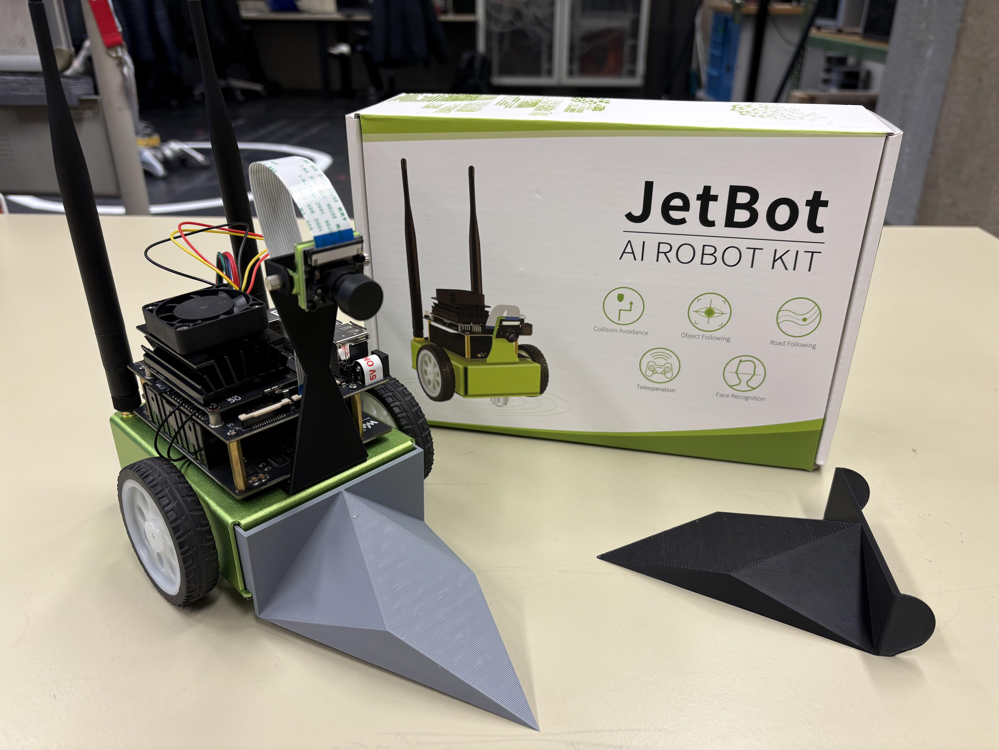

<h1 align="center">🤖 JetBot Nano AG</h1>

  

<h3 align="center">Hochschule Esslingen · Robotik-AG</h3>

Willkommen in der JetBot AG der Hochschule Esslingen!

In dieser AG bringen wir einen kleinen autonomen Roboter auf Basis des
**NVIDIA Jetson Nano** zum Leben: von den ersten Fahrbefehlen über Kamera
und Gamepad-Steuerung bis hin zu **künstlicher Intelligenz**, mit der der
Roboter selbstständig Hindernissen ausweicht.

Zum Abschluss designt jede Gruppe ein eigenes Addon für den 3D-Drucker
und tritt damit beim **Roboter-Sumo** gegen die anderen an. 🏆

---

## 📅 Ablauf

| Nr. | Thema | Inhalt |
|-----|-------|--------|
| 1 | Montage & Inbetriebnahme | JetBot zusammenbauen, einrichten, verbinden |
| 2 | Linux-Grundlagen | Terminal, Dateien, erste Befehle |
| 3 | Fahrschule | Motoren ansteuern, Fahrfiguren, eigene Steuerung |
| 4 | Teleoperation | Gamepad, Kamera, Fotos |
| 5 | Collision Avoidance | Daten sammeln, KI trainieren, autonom fahren |
| 6 | Sumo-Addon | eigenes Addon in FreeCAD designen und drucken |
| 7 | Roboter-Sumo | das große Finale |

---

## 📁 Was liegt wo?

| Ordner | Inhalt |
|--------|--------|
| `docs/` | Anleitungen als PDF und LaTeX-Quellen |
| `notebooks/` | Jupyter-Notebooks für den JetBot |
| `challenges/` | Challenges zu jedem Thema |
| `gruppen/` | **euer Bereich**: Code und CAD-Dateien eurer Gruppe |
| `gruppenfotos/` | **euer Gruppenfoto**, aufgenommen mit dem JetBot |

---

## 🚀 Loslegen

1. Die Inbetriebnahme-Anleitung in `docs/` durcharbeiten
2. JetBot einschalten und mit dem WLAN verbinden
3. Im Browser `http://<IP-des-JetBot>:8888` öffnen
   (die IP-Adresse steht auf dem kleinen Display am Roboter)
4. Mit dem ersten Notebook in `notebooks/` starten

---

## 📤 Eigene Dateien hochladen

Jede Gruppe hat einen eigenen Ordner unter `gruppen/`.
Wie ihr eure Dateien hochladet, steht in [`gruppen/README.md`](gruppen/README.md).

---

## 📸 Gruppenfoto

Als Abschluss der Teleoperation nehmt ihr mit dem JetBot ein Gruppenfoto auf.

1. Foto nach eurer Gruppe benennen, z. B. `gruppe_a.jpg`
2. In den Ordner `gruppenfotos/` legen und per Pull Request hochladen

Mehr dazu in [`gruppenfotos/README.md`](gruppenfotos/README.md).
Bitte nur Fotos hochladen, mit denen alle Abgebildeten einverstanden sind.

---

## ⚠️ Wichtige Regeln am JetBot

- **Kamera freigeben:** Vor dem Wechsel in ein anderes Notebook
  `camera.stop()` ausführen und über *Running → Shut Down All*
  alle Kernel beenden.
- **Nur eine Roboter-Instanz:** `robot = Robot()` nur **einmal**
  pro Notebook ausführen.
- **Sicher testen:** Beim ersten Ausprobieren den Roboter auf den Boden
  stellen, nicht an die Tischkante!
- **Notebooks aufräumen:** Vor dem Hochladen *Edit → Clear All Outputs*,
  damit keine Kamerabilder mit hochgeladen werden.

---

## 🛠️ Hardware

- Waveshare JetBot AI Kit
- NVIDIA Jetson Nano
- CSI-Kamera
- Gamepad (Xbox-360-Modus)

---

## 👥 Betreuung

- Reiner Marchthaler
- Marc Pentia Email: mapeit04@hs-esslingen.de

Bei Fragen oder Problemen einfach melden oder ein
[Issue](../../issues) erstellen.
